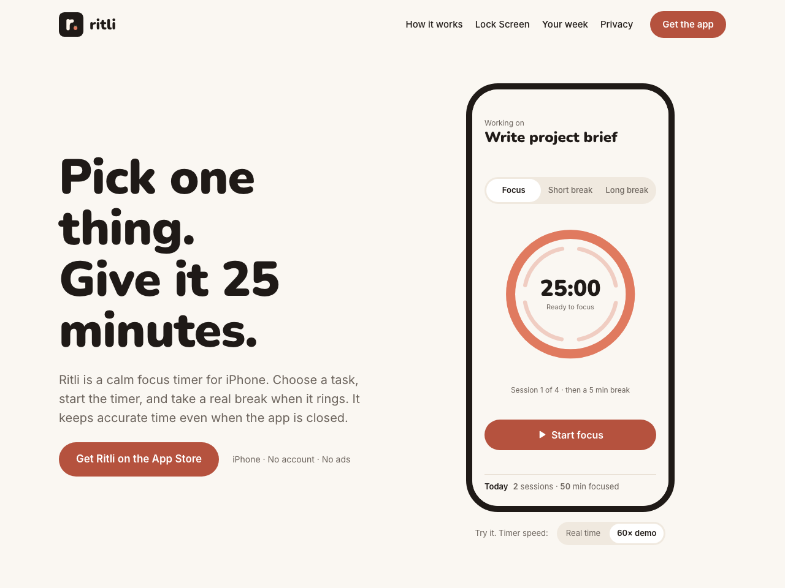
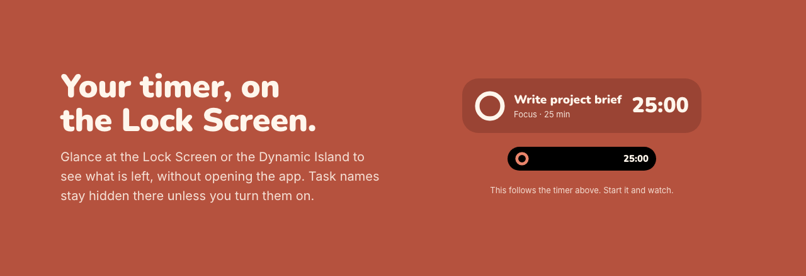
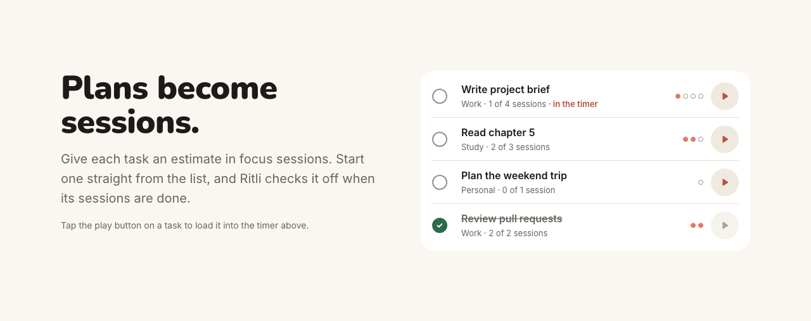
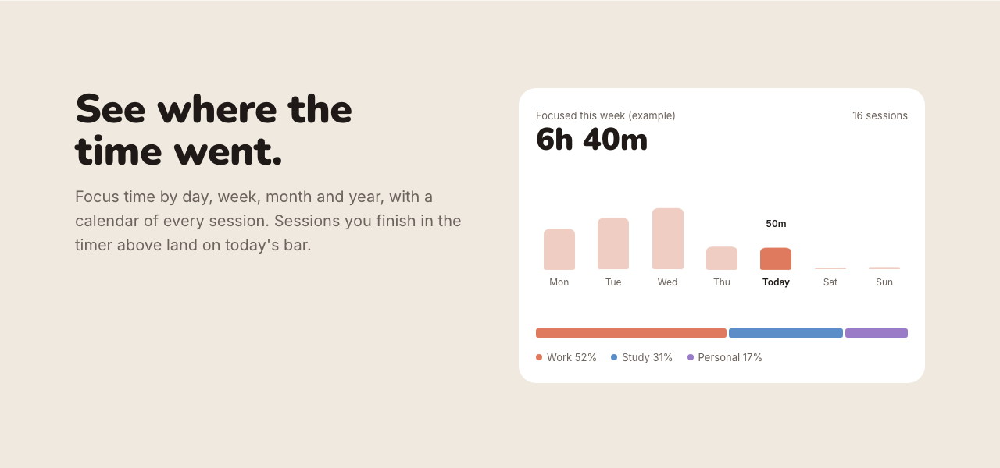
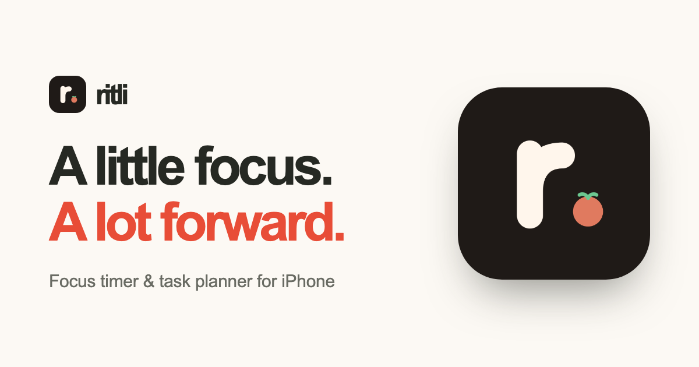

# Ritli

Ritli is a calm focus timer for iPhone: pick one thing, give it 25 minutes, then take a real break. This repository is the app's website, which introduces Ritli and sends visitors to the App Store.

[Get Ritli on the App Store](https://apps.apple.com/app/ritli-focus-timer/id6809929070)



## What Ritli does

- **Focus sessions with real breaks.** 25 minutes of focus, a short break, and a longer break after four sessions. The lengths can be changed and saved as routines.
- **Tasks that become sessions.** Each task gets an estimate in focus sessions, starts straight from the list, and is checked off when its sessions are done.
- **A timer on the Lock Screen.** The countdown shows on the Lock Screen and in the Dynamic Island, and keeps accurate time when the app is closed.
- **A clear picture of the week.** Focus time by day, week, month and year, with a calendar of every session.
- **Private by design.** No account, no ads, no analytics. Tasks, routines and history stay on the iPhone.

## What the website shows

The homepage walks a visitor through the app in the order they would use it:

1. **A working timer.** The phone at the top is a live Ritli timer that visitors can start, pause and speed up.
2. **How a session goes.** A short animated walkthrough of the four steps of a session.
3. **Lock Screen, tasks and the week.** These react to the timer above: finish a session there and it lands on a task and on today's bar in the chart.
4. **Privacy.** What Ritli does and doesn't keep, with a link to the full policy.
5. **Common questions.** Price, Pomodoro, accounts, stats and supported iPhones.
6. **Download.** The closing call to action.

**The timer on the Lock Screen**



**Tasks with session estimates**



**The week at a glance**



The tasks and the weekly chart are example data, not anyone's real activity.

There is one more page, the **Privacy Policy** at `/privacy`. It is the policy linked from the app and from App Store Connect, so its wording has to match what the app and its support process really do.

## Look and feel

The site follows the iOS app's design: paper and ink backgrounds, coral and terracotta for focus, leaf green for breaks, Nunito for headings and Inter for text. It supports light and dark mode.

All motion is optional. Visitors who turn on Reduce Motion, or whose browser doesn't support an effect, see the finished page with still images in place of the animations.

## Being found and shared

- **Search.** Each page tells search engines its preferred address, and the site publishes a sitemap. The homepage also describes the app and its FAQ in a format search engines can read.
- **Sharing.** Links shared in messengers and social networks show the preview card below (`public/og-image.png`).
- **iPhone visitors.** Safari shows a banner that opens Ritli in the App Store.
- **App Store link.** Every button uses one link with no country code, so Apple opens each visitor's own storefront.



## Making changes

| To change | Edit |
| --- | --- |
| Homepage text, sections and the FAQ list | `app/page.tsx` |
| The live timer, Lock Screen, tasks and week sections | `app/ritli-experience.tsx` |
| The animated walkthrough and logo | `app/remotion/` and `app/session-story.tsx` |
| Colours, type and layout | `app/globals.css` |
| The App Store link and the Ritli logo | `app/brand.tsx` |
| Privacy policy wording and its date | `app/privacy/page.tsx` |
| Page title, description and site address used for search and sharing | `lib/site.ts` |
| The list of pages in the sitemap | `scripts/write-seo-files.mjs` |
| The screenshots in this README | `docs/` |

To preview the site on your machine, use Node.js 24:

```sh
npm ci
npm run dev
```

## Publishing

The site is hosted on Vercel, which builds it with `npm run build:vercel` and publishes the result as a static site.

Search engines and share previews need the site's public address. Vercel supplies its production domain automatically; if that is not the address you want people to find, set a `SITE_URL` environment variable in the Vercel project.

Before publishing a change to the privacy policy, confirm it matches actual support practices and update its date. After publishing, open `/privacy` on the live site while signed out before pointing the app or App Store Connect at it.
